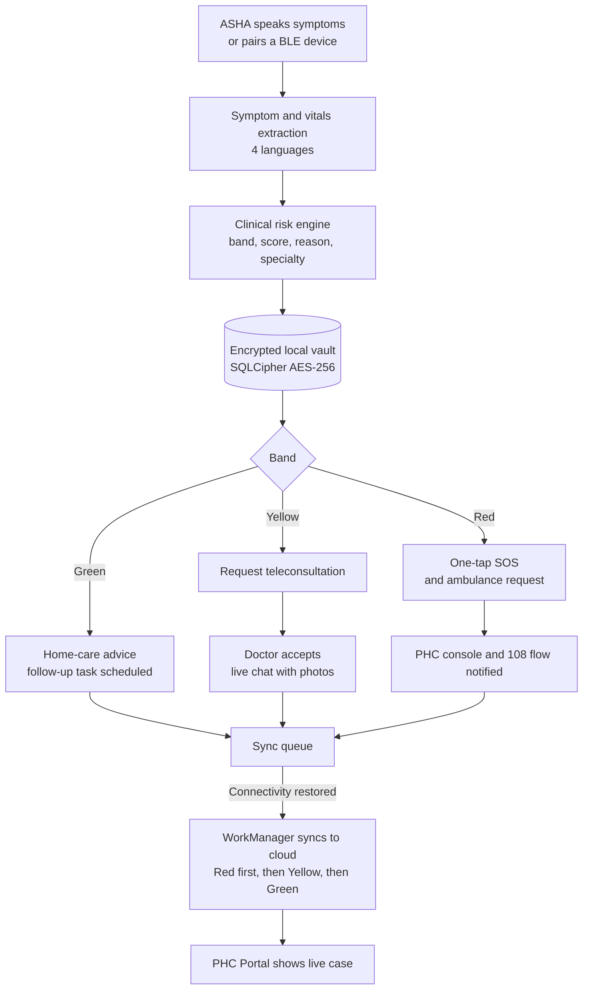
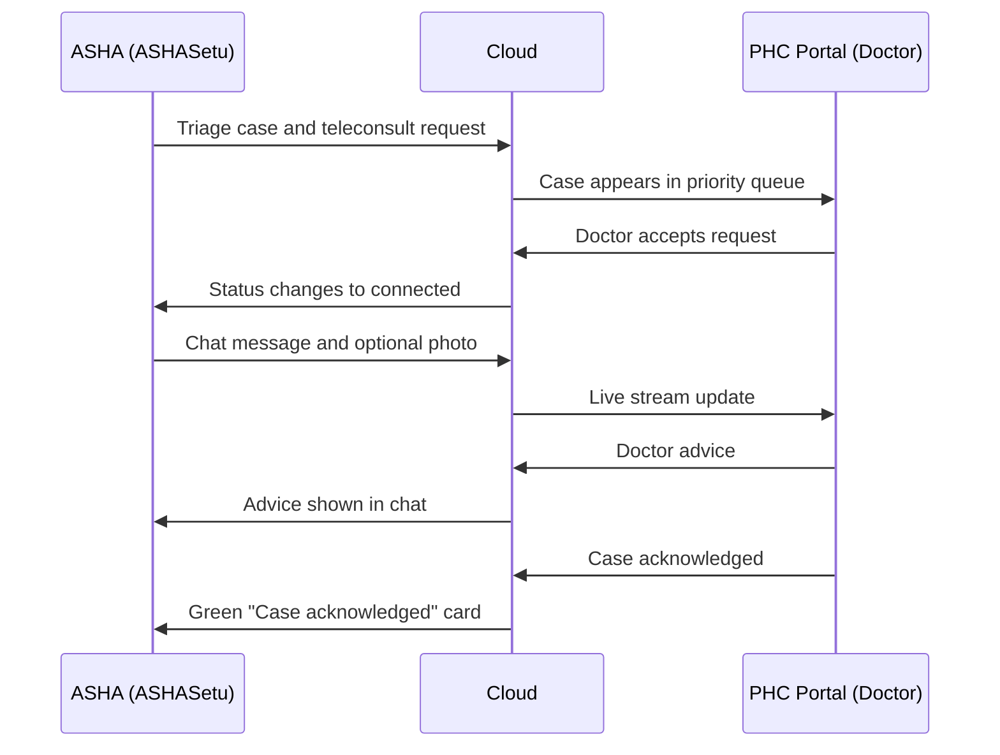
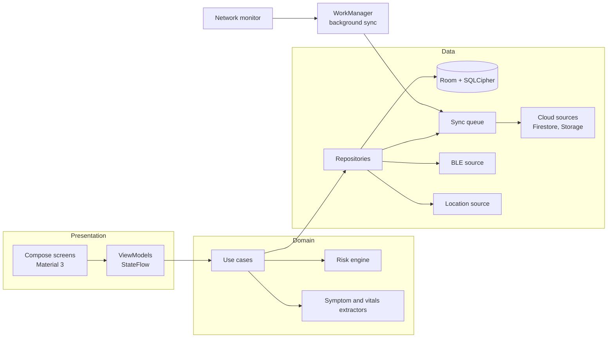
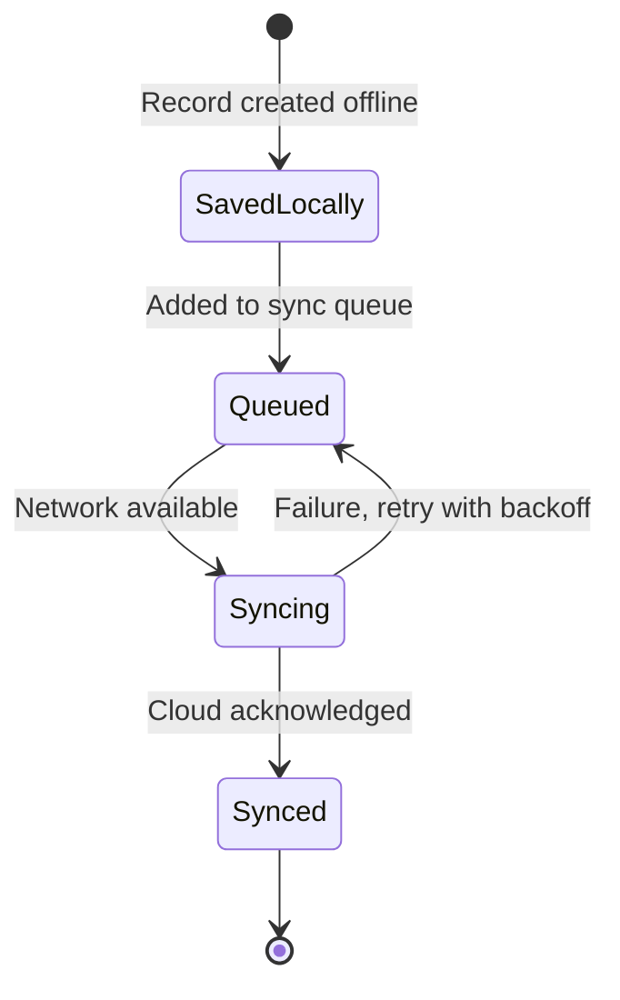

<div align="center">

# ASHASetu — आशा सेतू
### Offline-first voice triage and community care app for ASHA workers


[Why](#-why-ashasetu) · [Features](#-features) · [Workflow](#-how-it-works) · [Triage](#-clinical-risk-engine) · [Architecture](#-architecture) · [Sync](#-offline-vault--sync) · [Security](#-security--privacy) · [Build](#-build--run)

</div>

> **Disclaimer:** ASHASetu is a hackathon prototype built to support ASHA workflows under the National Health Mission. It is clinical **decision-support** software, not a certified medical device, and it is not an official government application. Final clinical decisions always rest with a qualified doctor.

---

## 🎯 Why ASHASetu

ASHA workers are the first point of care for millions of people, yet they often work in villages with weak or no connectivity, with paper registers, in several languages, and with no immediate access to a doctor. A late referral for a high-risk pregnancy can cost a life.

**ASHASetu puts a triage-grade clinic in the ASHA worker's phone**: speak symptoms in your own language, capture vitals, get an explainable Green / Yellow / Red risk band in seconds, and reach a PHC doctor or an ambulance, even if the network is down when you start.

| Challenge in the field | How ASHASetu responds |
| :--- | :--- |
| No or flaky signal | Everything works offline. Data is stored in an encrypted vault and synced automatically later. |
| Language barriers and typing burden | Voice input in Marathi, Hindi, Tamil and English with automatic symptom and vitals extraction. |
| Uncertainty about severity | Deterministic, explainable risk engine returns a band, a priority score and a clear reason. |
| Delay in reaching a doctor | One-tap teleconsultation with live chat and photo sharing. |
| Emergencies | One-tap SOS with GPS broadcast and 108 ambulance request. |
| Unknown hospital capacity | Referral screen shows nearby facilities with ICU, oxygen and blood-bank status and how recent that data is. |
| Missed follow-ups | Task list for ANC, immunisation, TB DOTS and hypertension, with overdue highlighting. |

---

## ✨ Features

### 🎙️ 1. Multilingual voice triage
- Voice input in **Marathi (`mr-IN`)**, **Hindi (`hi-IN`)**, **Tamil (`ta-IN`)** and **English (`en-IN`)** using Android's native speech recognizer.
- **Symptom extractor** matches clinical terms across all four languages (for example severe headache, vaginal bleeding, chest pain, high fever, reduced fetal movement, convulsions).
- **Vitals extractor** turns spoken numbers into structured vitals such as blood pressure, pulse, SpO₂ and haemoglobin ("BP 160 by 110", "SpO2 94 percent").

### 🧮 2. Clinical risk engine
- Deterministic scoring from **1 to 100** with an explicit clinical reason.
- Produces step-by-step action advice, the required **specialty** (Obstetrics, Cardiology, Neurology, Paediatrics, Trauma) and the recommended **facility tier** (PHC, CHC, Sub-District Hospital, District Hospital).

### 🧑‍🤝‍🧑 3. Patient registry and ABHA
- Registration with **ABHA ID**, ANC trimester, cohort (`ANC`, `TB`, `CHRONIC`, `CHILD`, `GENERAL`), village and responsible ASHA.
- **Incident and unattended-visit logging**, so field mishaps or missed visits reach the PHC.
- **Triage history** per patient with risk badges. Tapping an entry opens the full encounter.

### 👩‍⚕️ 4. PHC teleconsultation
- Sends the full triage packet to the PHC doctor queue as a teleconsult request.
- Shows a connection-pending screen until the doctor accepts.
- **Live two-way chat** with voice-to-text composition and **medical photo attachment**.
- Doctor acknowledgement and admin approval status update live on the case card.

### 🚨 5. One-tap SOS
- Captures device GPS and broadcasts an emergency alert with maternal risk details to the PHC console and the 108 command flow.

### 🏥 6. Referral and bed pre-booking
- Lists nearby District Hospitals, CHCs and PHCs with **ICU beds, oxygen, blood bank, distance and data staleness**.
- Pre-books a bed and raises a **108 ambulance request**. Live ambulance status returns to the app as a pop-up and status card.

### 📅 7. Follow-up and task management
- Scheduled tasks for high-risk ANC visits, infant vaccination, TB DOTS adherence and hypertension monitoring, with overdue highlighting.

### ⌚ 8. Wearable and sensor integration
- **Bluetooth Low Energy** pairing with pulse oximeters and heart-rate monitors, streaming vitals straight into the triage form.

### 🔐 9. Offline vault and background sync
- Room database encrypted with **SQLCipher AES-256**.
- Every change is queued and flushed to the cloud by **WorkManager** when connectivity returns, in priority order.

### 📍 10. Frontline worker telemetry
- Periodically reports worker location, battery level, network type and pending-sync count so the PHC can see field coverage and sync health. Intended for use with the worker's informed consent.

---

## 🔄 How It Works



### Teleconsultation sequence



---

## 🩺 Clinical Risk Engine

| Band | Priority score | Example triggers | Suggested action |
| :--- | :---: | :--- | :--- |
| 🔴 **RED** (Emergency) | **85–100** | Severe pre-eclampsia, postpartum haemorrhage, SpO₂ below 90%, fetal heart rate below 110 or above 160, BP at or above 160/110 | Immediate referral to a District Hospital or trauma centre, dispatch 108 |
| 🟡 **YELLOW** (Urgent) | **50–84** | Moderate anaemia (Hb 7.0–9.9 g/dL), BP 140–159 / 90–109, moderate fever | Same-day teleconsultation |
| 🟢 **GREEN** (Routine) | **10–49** | Routine ANC / PNC, stable vitals | Home care and scheduled follow-up |

The engine is deterministic and explainable, and every result carries its clinical reason. A machine-learning risk layer with feature-level explanations is on the roadmap. Red-flag rules will always run first and bypass it.

---

## 🏗️ Architecture

Clean Architecture with MVVM and unidirectional state flow.



### Module map

| Area | Responsibility |
| :--- | :--- |
| Triage capture | Voice input, symptom and vitals extraction, risk scoring |
| Patient registry | Registration, ABHA, cohorts, incidents, triage history |
| Teleconsult and chat | Request routing, live chat, photo attachments |
| SOS | Location capture and emergency broadcast |
| Referral | Facility status, bed pre-booking, ambulance request |
| Follow-up | Task scheduling and overdue tracking |
| Wearables | BLE pairing and vitals streaming |
| Sync | Queue, retry, network monitoring, background worker |
| Telemetry | Worker status reporting |

---

## 🔐 Offline Vault & Sync

### Local encrypted vault

| Data set | Purpose |
| :--- | :--- |
| Patients | Registry, ABHA, cohort, incidents and unattended reasons, sync state |
| Triage records | Symptoms, vitals, risk band, score, specialty, summary, advice |
| Referrals | Referral status and transport arrangement |
| Facilities | Cached capacity data with staleness indicator |
| Follow-up tasks | Due dates, overdue flag, completion |
| Sync queue | Pending outbound changes with retry count |
| Activity log | Local audit trail of actions |

### Sync behaviour



- **Priority order:** Red, then Yellow, then Green.
- **Resilient:** retries are counted and failed items stay in the queue, never dropped.
- **Visible:** the worker can see what is pending and what has synced.

### Cloud channels

| Direction | Channel | Purpose |
| :--- | :--- | :--- |
| App → Cloud | Patients, triage cases, case chat stream | Records and live conversation |
| App → Cloud | Teleconsult requests | Ask a PHC doctor to connect |
| App → Cloud | SOS alerts, ambulance requests | Emergency escalation |
| App → Cloud | Worker telemetry | Field coverage and sync health |
| Cloud → App | Request status, case acknowledgement, admin approval | Live status cards |
| Cloud → App | Doctor chat messages | Real-time advice |
| Cloud → App | Ambulance status | "Ambulance on the way" alert |

---

## 🛡️ Security & Privacy

| Area | Implementation |
| :--- | :--- |
| Data at rest | SQLCipher AES-256 encrypted Room database |
| Data in transit | TLS via Firebase SDKs |
| Secrets | No credentials, keys or patient data are committed to this repository |
| Audit | Local activity log for every significant action |
| Regulation | Built with DPDP Act 2023 principles in mind: consent, purpose limitation, data minimisation |

**Hardening roadmap before any real deployment:**
- Store the database key in the Android Keystore, protected by biometric or device credentials.
- Enforce per-role Firestore security rules and enable Firebase App Check.
- Route teleconsult requests to the on-duty doctor assigned to the PHC rather than a fixed identity.
- Add certificate pinning and a remote wipe path for lost devices.
- Make worker-location telemetry explicitly consent-based and time-bounded.

> All names, IDs, phone numbers and values appearing in screenshots, demos and tests are synthetic.

---

## 🧰 Tech Stack

| Layer | Technology |
| :--- | :--- |
| Language | Kotlin 1.9 |
| UI | Jetpack Compose, Material 3, Navigation Compose |
| Architecture | Clean Architecture, MVVM, StateFlow |
| Dependency injection | Hilt |
| Local storage | Room with SQLCipher |
| Cloud | Firebase (Firestore, Storage) |
| Speech | Android `SpeechRecognizer` |
| Background work | WorkManager |
| Images | Coil |
| Async | Kotlin Coroutines |

---

## 🚀 Build & Run

### Prerequisites
- A recent stable **Android Studio**
- **JDK 17**
- Android device or emulator, **API 24+**
- Your own **Firebase project** (Firestore and Storage enabled)

### Steps

```bash
# 1. Clone
git clone https://github.com/<your-org>/<your-repo>.git
cd <your-repo>

# 2. Add your own Firebase config (see note below)
#    place google-services.json inside androidApp/

# 3. Build a debug APK
./gradlew :androidApp:assembleDebug

# 4. Install on a connected device
adb install -r androidApp/build/outputs/apk/debug/androidApp-debug.apk
```

> **Never commit `google-services.json`, keystores or `.env` files.** Confirm they are listed in `.gitignore`. If any were committed earlier, rotate those keys and purge them from git history.

### Runtime permissions
Microphone (voice input), location (SOS and telemetry), Bluetooth (wearables) and camera or media access (chat photos). Each is requested only when the related feature is used.

---

## ⚠️ Current Limitations

- Speech recognition uses Android's built-in engine, so accuracy varies by device and dialect. Fully on-device Indic ASR is planned.
- Symptom extraction is rule-based, not ML-based.
- The risk engine has not been clinically validated and must not be used for real patient care.
- LoRa dead-zone relay is designed at platform level and is not part of this app build.

## 🗺️ Roadmap

- [ ] On-device quantized Indic ASR and entity extraction
- [ ] ML risk layer with feature-level explanations
- [ ] LoRa uplink module for zero-signal villages
- [ ] Android Keystore-backed key management and biometric gate
- [ ] More languages (Telugu, Kannada, Bengali, and others)
- [ ] ABDM-certified ABHA flows

---

## 🔗 Related

- **SevaSetu PHC Portal**: the web dashboard this app talks to.
- **SevaSetu Platform overview**: full architecture and vision.

## 👥 Team

Built by **Team Cantina** 


