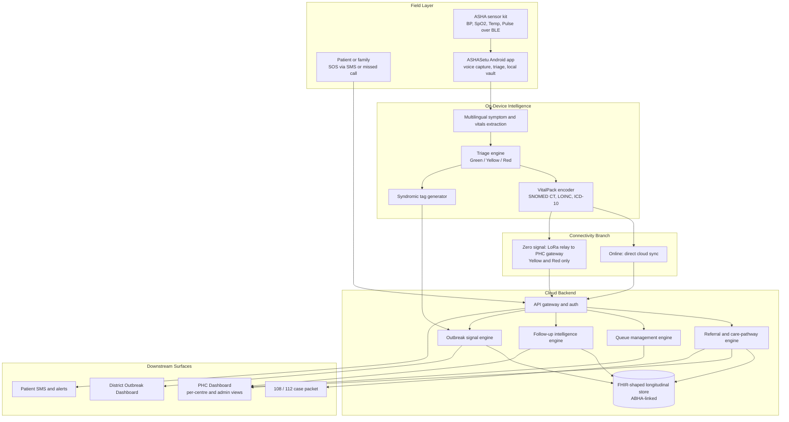
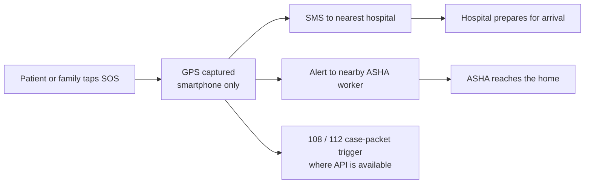
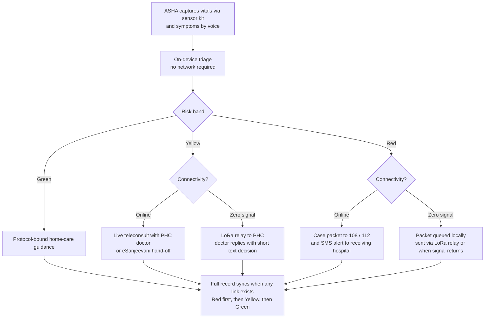
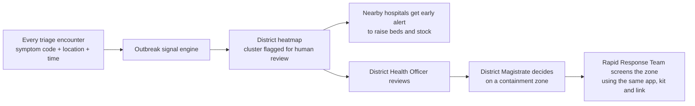
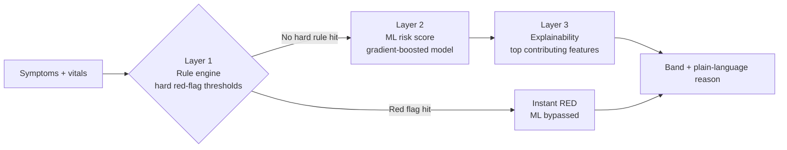

# SevaSetu — सेवासेतु
### The offline-first data layer that connects ASHA workers, PHCs and district hospitals in hilly taluks of karnataka.

[🚀 Live Demo](#-live-demo--videos) · [The Problem](#-the-problem) · [Our Solution](#-our-solution) · [Architecture](#-system-architecture) · [Workflows](#-end-to-end-workflows) · [Engines](#-core-engines) · [Integrations](#-integration-first-not-reinvention-first) · [Build Status](#-implementation-status) · [FAQ](#-faq)

> **Disclaimer:** SevaSetu is an independent hackathon prototype. It is not an official Government of India product and is not affiliated with MoHFW, NHM, NHA or any state health department. It is clinical **decision-support** software, not a certified medical device.
>**Imp Note:** We have implemented Hardware just to address the Offline Scenario in the hilly taluks and villages. It is just an additional part of our project and doesn't influence **Final-product**. **We the team Cantina, promise that we do have knowledge that Devhack'26 is fully software-based and we do abide by that ,and we do respect it**

---

## 🚀 Live Demo & Videos

| Resource | Link |
| :--- | :--- |
| 🌐 **Deployed PHC Portal** | [**Open the live app →**](https://YOUR-DEPLOYMENT-LINK) |
| 🎬 **Video 1: Project Walkthrough / Demo** | [**Watch on YouTube →**](https://www.youtube.com/watch?v=ap-gmuTtrpQ) |
| 🎬 **Video 2: Animated demo** | [**Watch on YouTube →**](https://www.youtube.com/watch?v=CpFEbZ00S2Y) |

---

## 🧭 The Problem

India's public health system already has the people and the infrastructure: ASHA workers, sub-centres, PHCs, district hospitals, 108/112 emergency dispatch and the IHIP disease-surveillance platform. What breaks down in rural and underserved areas is the **data layer between them**:

- Connectivity drops exactly where care is needed most, so digital tools quietly stop working in the field.
- Patient records are fragmented, so continuity of care is lost between visits and facilities.
- Referrals are made by distance alone, without knowing whether the destination has the specialty, bed or stock.
- Emergency hand-offs happen as verbal phone descriptions, which are slow and lossy.
- Disease-surveillance depends on separate manual reporting forms on top of an already heavy ASHA workload.

## 💡 Our Solution

**SevaSetu ("Service Bridge") captures triage-grade patient data even with zero signal, encodes it into standard clinical codes, routes each case to where care capacity actually exists, and turns the same data into an early-warning signal for the district. It does all of this without duplicating any national system already doing part of the job.**

| Pillar | What it does |
| :--- | :--- |
| 📴 **Offline-first capture** | ASHA workers triage fully offline: voice symptoms in regional languages, vitals from a BLE sensor kit, on-device risk classification. |
| 📡 **Dead-zone bridge** | A LoRa radio link relays Yellow and Red case summaries to the nearest PHC when there is no cellular signal at all. |
| 🧠 **Explainable triage** | Hybrid rule and ML engine. Every Green / Yellow / Red result comes with a plain-language clinical reason, never a bare number. |
| 🏥 **Capacity-aware referral** | Facilities are ranked by specialty match, live capacity, stock and travel time, not distance alone. |
| 🚑 **Emergency hand-off** | Red cases generate a structured, pre-triaged case packet for 108/112 instead of a verbal description. |
| 🦠 **Free outbreak signal** | Each encounter emits an anonymous syndromic tag that feeds a district heatmap and an IHIP-compatible export. |
| 🔁 **Continuity of care** | ABHA-anchored longitudinal records, aftercare schedules and defaulter alerts. |

---

## 🧩 Platform Components

| Component | Audience | Surface | Repository |
| :--- | :--- | :--- | :--- |
| **ASHASetu** | ASHA / ANM workers | Android app, offline-first | [`ASHASetu` (Android)](./) |
| **SevaSetu PHC Portal** | PHC doctors, facility staff, PHC admins | React web dashboard | [`SevaSetu` (Web)](./) |
| **Patient touchpoints** | Patients and families | SMS, missed-call/IVR SOS, lightweight read-mostly app | Design |
| **District Outbreak Dashboard** | District Health Officers | Heatmap and trend view | Design |
| **LoRa dead-zone link** | ASHA ↔ PHC backhaul | Radio module and PHC gateway | Design / simulated |

> Update the repository column with your actual repo links before publishing.

---

## 🏗️ System Architecture

**Design principle:** *Cloud-connected, not cloud-dependent. Integration-first, not reinvention-first.*
Every core ASHA action completes with zero network. Every emergency and surveillance function hands off to the national system built for it.

---

## 🔄 End-to-End Workflows

A case starts one of two ways. Everything downstream (referral, sync, outbreak detection) works identically for both.

### Scenario A: Patient raises their own emergency

The SOS path rides on **SMS (GSM)** rather than a data connection, so it works even on weak signal.

### Scenario B: ASHA worker visit (online or offline)

**Offline Yellow round trip:** the case summary leaves the ASHA phone over LoRa, appears on the PHC dashboard, a doctor sends back a short text decision, and the reply reaches the ASHA phone. In many cases the patient avoids an unnecessary trip to the PHC.

### Downstream: outbreak signal and containment escalation

The system raises the flag. **Only government officials declare a containment zone or dispatch teams.**

---

## ⚙️ Core Engines

### 1. Hybrid explainable triage

- **Rules always run first and always run offline.** Danger signs such as critical hypoxia, severe hypertension in pregnancy or fetal distress classify as Red immediately.
- **ML layer** scores remaining cases and surfaces its top contributing factors as a readable reason.
- **Governing rule:** the engine is decision support only. A doctor holds final authority before any non-emergency referral is finalized.

### 2. VitalPack: low-bandwidth clinical encoding
A compact transport schema that maps symptoms to **SNOMED CT**, vitals and labs to **LOINC**, and provisional impressions to **ICD-10**, using delta and varint encoding for numeric values. It is a transport layer over real standards, convertible to FHIR R4 on sync. It is not a proprietary medical protocol.

### 3. Referral and care-pathway engine
`match_score = f(specialty_match, current_capacity, travel_time, historical_completion_rate)`

- **Graceful degradation:** stale or missing capacity data falls back to distance-based ranking and is flagged as stale.
- **Capacity-exhaustion escalation:** if no facility in range has confirmed capacity, the case escalates to the District Admin view for manual reallocation instead of defaulting to the nearest full facility.

### 4. Queue management
Weighted priority queue per facility with an aging factor, so Green patients are never starved indefinitely.

### 5. Offline sync and conflict resolution
UUIDs with logical clocks, idempotency keys, an append-only clinical event log, retry with a dead-letter queue, and **Red-first priority** across both the cloud path and the LoRa gateway.

### 6. Follow-up intelligence
Rule-based scheduler tied to government protocols such as ANC cadence, TB DOTS follow-up and hypertension or diabetes review intervals. It refreshes at every ASHA visit and raises defaulter alerts on the PHC dashboard.

### 7. Outbreak signal engine
Aggregates syndromic tags by geography and time window, applies a rate-of-rise threshold per zone and symptom code, and flags candidate clusters for human review. It formats the same data to IHIP's **S / P / L** structure for export.

### 8. Protocol-bound Green assistant
Deliberately **not** an open generative chatbot. Responses are limited to pre-approved home-care content and the triage engine's own reasoning strings, which keeps clinical-safety risk low while shortening Green visits.

---

## 📡 The LoRa Dead-Zone Bridge

LoRa has one narrow job: get a Yellow or Red case out of a village with **no cellular signal**.

| Aspect | Design decision |
| :--- | :--- |
| **Hardware** | LoRa module paired with the ASHA phone, plus a fixed gateway at the PHC mounted high (rooftop or water tower). |
| **Band** | India's licence-free 865–867 MHz ISM band. |
| **Realistic range** | About 3–8 km in hilly or forested terrain, up to 15–20 km over open terrain with an elevated gateway. We plan around the real number, not the 25 km marketing figure. |
| **Payload** | Only the compact VitalPack summary: risk band, symptom codes, reasoning string, GPS. Never audio, video or large files. |
| **Priority** | Red transmits first, Yellow second. Green is one-way for the outbreak signal and never competes for airtime. |
| **Not in scope** | It cannot reach a patient's normal phone and does not replace SMS or 108/112. Once a case reaches the PHC gateway, it continues over the PHC's regular connection. |

---

## 🔌 Integration-First, Not Reinvention-First

| National system | Our role |
| :--- | :--- |
| **ABHA / ABDM** | Patient identity anchor and portable longitudinal records, following ABDM's federated consent-manager pattern. |
| **eSanjeevani** | Primary teleconsultation hand-off where a doctor slot exists. |
| **108 / 112 (ERSS)** | Receives a structured, pre-triaged case packet. We run no ambulance fleet of our own. |
| **IDSP / IHIP** | Receives an automatic IHIP-format export generated as a byproduct of routine triage. We feed it better data, we do not compete with it. |
| **Health Facility / Professional Registries** | Reference source for facility and doctor verification (roadmap). |

---

## 🗂️ Data Model & Standards

- **Identity:** ABHA ID wherever available. A local pseudonymous ID is used offline and reconciled on sync.
- **Records:** internally modelled as FHIR R4 resources (Patient, Condition, Observation, ServiceRequest).
- **Terminology:** SNOMED CT for conditions, LOINC for vitals and labs, ICD-10 for provisional impressions.
- **Surveillance export:** aggregated, de-identified syndromic data in IHIP S / P / L structure.
- **Consent:** federated, consent-manager based, with no central data pool.

---

## 🔐 Security & Privacy

| Layer | Mechanism |
| :--- | :--- |
| Data at rest on device | AES-256 via SQLCipher. Biometric unlock gates app access and is not a substitute for encryption. |
| Data in transit | TLS for all sync traffic, with payload signing for tamper detection (integrity, not confidentiality). |
| Cloud data at rest | Managed-key encryption on database and object storage. |
| Access control | Authenticated, role-based access: ASHA, doctor, facility staff, PHC admin, district admin. |
| Auditability | Access log of record views (who and when); clinical actions signed with the acting user's ID. |
| Surveillance data | Syndromic tags carry symptom code, coarse location and time only, with no direct identifiers. |
| Regulation | Designed around the DPDP Act 2023: consent capture, purpose limitation, breach-notification readiness. |

---

## ✅ Implementation Status

Honest scoping matters more than a long feature list.

| Capability | Status |
| :--- | :--- |
| ASHASetu Android app: voice triage, rule-based risk engine, encrypted offline vault, priority sync, SOS, teleconsult chat, referrals, follow-ups, BLE pairing | ✅ **Built** |
| SevaSetu PHC Portal: command dashboard, triage queue, patient EHR, SOS console, referrals, inventory, follow-ups, reports, multilingual UI | ✅ **Built** |
| ABHA-linked patient identity and FHIR R4-shaped export | ✅ **Built** (prototype level) |
| BLE sensor-kit vitals stream | 🧪 **Pairing built**; demo may use a simulated stream |
| LoRa dead-zone link | 🧪 **Simulated** in software for the demo |
| 108 / 112 case packet and IHIP S / P / L export | 🧪 **Generated and displayed**; live API connection is roadmap |
| District outbreak heatmap and cluster flagging | 🛠️ **Prototype / in design** |
| ML risk layer and SHAP-style explanations | 🗺️ **Roadmap** (rule engine is what runs live) |
| ABDM M1–M3 certification, production hardening | 🗺️ **Roadmap** |

> Adjust this table to match your final build before submission.

---

## 🧰 Technology

| Layer | Prototype (this repo) | Production reference architecture |
| :--- | :--- | :--- |
| Android app | Kotlin, Jetpack Compose, Room + SQLCipher, WorkManager | Same, with ONNX Runtime Mobile for ML |
| Web portal | React, TypeScript, Vite, Tailwind CSS, Leaflet | Same |
| Realtime backend | Google Cloud Firestore and Storage | API gateway, containerized microservices, PostgreSQL, message queue with dead-letter handling |
| Speech and NLP | Android `SpeechRecognizer`, regex clinical term matchers | Quantized on-device ASR and IndicBERT-class entity extractor |
| Standards | FHIR R4-shaped, SNOMED CT, LOINC, ICD-10 | Same, with ABDM certification |
| Dead-zone link | Software simulation | LoRa module and PHC gateway |

---

## 🌍 Impact & Scale

- **Accessible hardware:** the sensor kit is a low-cost accessory in the ₹1,500–2,500 class, not medical-grade equipment.
- **Fewer unnecessary trips:** offline Yellow tele-triage often resolves a case without the patient travelling, which matters most during outbreaks when queues themselves spread disease.
- **Zero extra effort for ASHAs:** surveillance data is a byproduct of work already being done.
- **Scales without redesign:** stateless services and per-PHC onboarding.
- **Surge-resilient:** offline triage keeps working under congested networks, and escalation uses existing national infrastructure rather than competing with it.

---

## ⚠️ Risks & Mitigations

| Risk | Mitigation |
| :--- | :--- |
| Shared sensor hardware spreads infection | Mandatory disinfection or disposable probe covers, built into visit time. |
| NLP misreads dialect or free speech | Rule engine is a hard-flag fallback. A doctor confirms before any non-emergency dispatch. |
| Duplicate processing on sync retry | Idempotency keys on every locally generated event. |
| Stale facility or stock data | Distance-based fallback, stale-data flags, district escalation on exhaustion. |
| LoRa range overestimated | Gateway placement planned around 3–8 km realistic range with elevated antennas. |
| Many ASHAs share one gateway in a surge | Red-first priority scheduling, Green one-way. |
| Misreading LoRa as a cellular replacement | Scoped explicitly as an ASHA-to-PHC bridge only. |
| Single SMS number throttled under load | Per-district SMS numbers. |

---

## ❓ FAQ

**Why not just use eSanjeevani?** We integrate with it for the teleconsult leg. Our value is offline capture, explainable triage and capacity-aware referral before a teleconsult even happens.

**Why not just use 108?** We use it. We give the dispatcher a pre-triaged, structured case packet instead of a verbal description.

**Why not just use IHIP?** IHIP does real-time surveillance well. Its gap is the separate manual form health workers must fill. We generate the same signal automatically and export it in IHIP's own format.

**Is the AI safe to act on?** Every Red decision traces to an explicit clinical rule or an explainable feature list. A doctor has final authority on non-emergency dispatch, and the Green assistant is protocol-bound rather than open generative AI.

**What if every nearby facility is full?** The referral engine escalates to the district admin view for manual reallocation instead of silently defaulting to a full facility.

**Does LoRa replace cellular?** No. It bridges only the ASHA-to-PHC leg in a true dead zone. Patient SMS and 108/112 still use cellular.

**Who declares a containment zone?** The government, always. We flag the cluster earlier; the District Magistrate decides.

**How is this different from existing ASHA digitisation tools?** Most digitise forms. We add a decision layer (triage), a routing layer (capacity-aware referral) and a surveillance layer (outbreak signal), all FHIR-shaped and designed to feed national systems.

---

## 🗺️ Roadmap

1. Live 108/112 and IHIP integrations.
2. Train and validate the ML triage layer on real clinical data, with clinician review.
3. ABDM M1–M3 certification and Health Facility Registry integration.
4. Physical LoRa pilot with PHC gateway field testing.
5. Per-district SMS hardening and IVR language expansion.
6. Production security hardening and analytics warehouse.

---

## 👥 Team

Built by **Team Cantina**.
