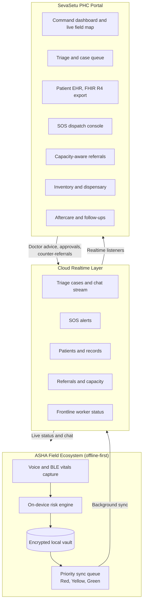
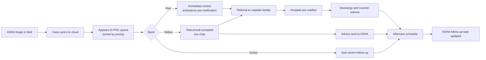
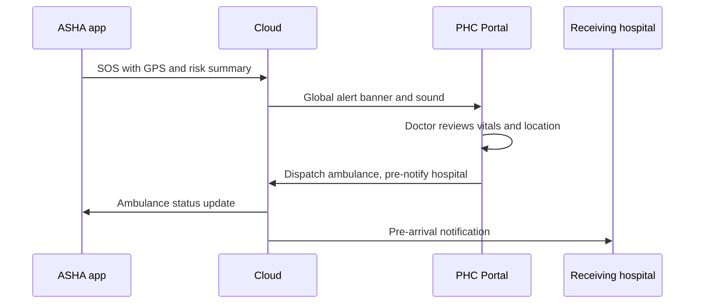
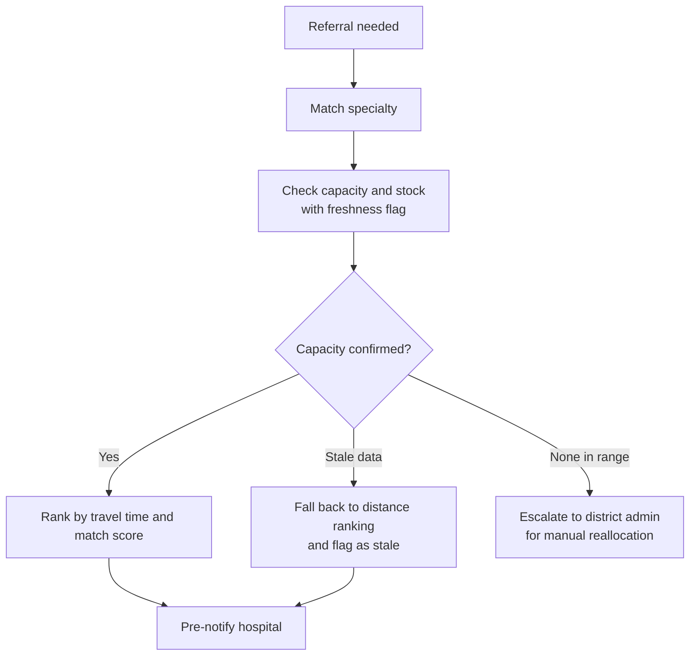

<div align="center">

  
<div align="center">

# SevaSetu PHC Portal — सेवासेतु
### Live tele-triage, emergency and aftercare command centre for Primary Health Centres

**Part of the SevaSetu platform · Smart India Hackathon, PS 26133**


[Overview](#-overview) · [Architecture](#-architecture) · [Features](#-features) · [Workflows](#-key-workflows) · [Stack](#-technology-stack) · [Quick Start](#-quick-start) · [Security](#-security--privacy)

</div>

> **Disclaimer:** This is an independent hackathon prototype inspired by India's public-health workflows. It is not an official Government of India portal and is not affiliated with MoHFW, NHM or NHA. Any emblem or tricolour styling is used only as a design reference for a prototype. Replace it with your own branding before any real-world use. The portal supports clinical decision-making and does not replace a doctor's judgement.

---

## 🏛️ Overview

Primary Health Centres in rural and tribal India deal with unreliable connectivity, language barriers among grassroot ASHA workers, crowded outpatient departments and little real-time visibility of specialist capacity at district hospitals.

**The SevaSetu PHC Portal is the command centre of the platform.** It receives live, prioritised cases from the offline-first **ASHASetu** Android app, lets Medical Officers triage, consult and refer in real time, manages emergencies through an SOS console, and closes the loop with **aftercare**: follow-ups, counter-referrals and ASHA task updates.

| Who | What they do here |
| :--- | :--- |
| 🩺 **Medical Officer / Doctor** | Review the live triage queue, accept teleconsults and chat with ASHAs, prescribe, refer, respond to SOS. |
| 🏢 **PHC Administrator** | Manage ASHA workforce, inventory, appointments, district reporting and approvals. |

---

## 🏗️ Architecture



---

## 🚀 Features

### 1. 📊 PHC command dashboard
- Live summary of active cases by risk band, open SOS alerts, queue length and stock alerts.
- **Live field map** (Leaflet and OpenStreetMap) showing ASHA worker positions, network state and pending-sync health.

### 2. 🩺 Triage and case queue
- Real-time queue sorted by priority: 🔴 **RED** (critical, immediate), 🟡 **YELLOW** (urgent, same-day teleconsult), 🟢 **GREEN** (routine, sub-centre follow-up).
- Each case shows vitals, symptoms, the risk reason and the recommended specialty.
- **Teleconsult approval and live chat** with the ASHA worker, including photo attachments.
- Case acknowledgement and resolution flow that updates the ASHA's app instantly.

### 3. 🚨 SOS emergency console
- Instant audio-visual alert and a **global emergency banner** across every screen when an ASHA triggers an SOS.
- Shows patient vitals, location and nearest suitable facility, with ambulance dispatch routing.
- Quick access to the national emergency number **112** and the state health helpline.

### 4. 🗂️ Longitudinal patient EHR
- ABHA-linked patient profiles with encounters, prescriptions, investigations and ASHA field-visit history.
- **FHIR R4-shaped JSON export** for interoperability.
- Clinical terminology aligned to SNOMED CT, LOINC and ICD-10.

### 5. 🚑 Capacity-aware referral network
- Live bed, ICU, oxygen, blood-bank and specialist availability across district facilities, with data-freshness indicators.
- Pre-notifies the receiving hospital so patients are not sent to a facility that cannot take them.
- Escalation path for district-wide capacity exhaustion.

### 6. 🔁 Aftercare and follow-up continuity
- High-risk ANC, child health and chronic-care follow-up protocols with defaulter alerts.
- **Closed-loop counter-referrals:** when a patient is discharged, the responsible ASHA's follow-up schedule updates automatically.
- Visit history flows back into the longitudinal record.

### 7. 👩‍🌾 ASHA workforce management
- Worker roster, live status, sync health and coverage view.
- Accreditation and assignment management for administrators.

### 8. 💊 Dispensary and inventory
- Essential drug stock tracking with low-stock and expiry alerts.
- Inventory feeds the referral engine so routing reflects real availability.

### 9. 🗓️ Appointments and OPD queue
- Token and slot management, check-in and "mark as attended" actions.

### 10. 📈 Reports and analytics
- Monthly HMIS-style reports and epidemiological views.
- Quality metrics such as referral completion, time-to-consult and follow-up adherence.

### 11. 🌐 Multilingual interface
- One-click switch between **English, हिन्दी and தமிழ்** in the header.
- Non-destructive translation layer for labels, navigation, status pills and medical terms that leaves form inputs, filters and data keys untouched.
- Noto Sans Devanagari and Noto Sans Tamil typography.

### 12. ♿ Accessibility
- Text-size controls (`A-`, `A`, `A+`) in the utility bar.
- Layout and contrast designed with Indian government web guidelines (GIGW) in mind.

### 13. 🔐 Role-based access
- Separate **Admin** and **Doctor** workspaces with route-level access control.
- Registration flows for administrators and medical officers.

---

## 🔄 Key Workflows

### Case lifecycle



### Emergency SOS



### Referral decision



---

## 🧰 Technology Stack

| Layer | Technology |
| :--- | :--- |
| Framework | React 19, TypeScript 5.7, Vite 8 |
| Styling | Tailwind CSS v4 with custom theme tokens |
| Motion | `motion/react` |
| Maps | Leaflet 1.9, OpenStreetMap |
| Realtime backend | Google Cloud Firestore (live listeners), Firebase Storage |
| Icons | Lucide React |
| Clinical standards | FHIR R4, SNOMED CT, LOINC, ICD-10 |

---

## 📂 Project Structure

```
sevasetu-portal/
├── public/                 # Static assets and logo
├── src/
│   ├── auth/               # Session state, role management, auth service
│   ├── components/         # Header, Sidebar, SOS banner, LiveMap, shared UI
│   ├── context/            # Language provider and translation dictionary
│   ├── services/           # Firestore data layer and realtime listeners
│   ├── views/              # Dashboard, Triage, Patients, Referrals, Appointments,
│   │                       # ASHAWorkers, Inventory, Followups, SOS, Reports,
│   │                       # Settings, Login, registration screens
│   ├── App.tsx             # Routing and access control
│   ├── index.css           # Tailwind v4 and Indic fonts
│   └── main.tsx            # Entry point
├── .env.example            # Environment template (no real values)
├── package.json
├── tsconfig.json
└── vite.config.ts
```

---

## 📦 Quick Start

### Prerequisites
- **Node.js** 18 or later (20+ recommended)
- **npm** 9 or later
- Your own **Firebase project** with Firestore and Storage enabled

### Install and run

```bash
# 1. Clone
git clone https://github.com/<your-org>/<your-repo>.git
cd <your-repo>

# 2. Install dependencies
npm install

# 3. Configure environment
cp .env.example .env
#    Fill in the values from your own Firebase project settings.

# 4. Start the dev server
npm run dev
#    Open the local URL printed in the terminal.

# 5. Type-check and lint
npm run lint
```

> **Never commit `.env` or any real credentials.** Confirm `.env` is in `.gitignore`. If any key or password was ever committed, rotate it and remove it from git history.

### Demo access
Evaluator accounts are provisioned in a seeded demo project and are intentionally **not published in this repository**. Contact the team for access. Demo data is entirely synthetic.

---

## 🔒 Security & Privacy

| Area | Approach |
| :--- | :--- |
| Access control | Role-based separation of administrative and clinical workspaces, enforced on routes and in data rules |
| Transport | HTTPS/TLS for all traffic to the backend |
| Secrets | Environment-based configuration, nothing sensitive in source control |
| Auditability | Triage decisions, referrals and prescriptions are timestamped and attributed to the acting user |
| Regulation | Designed with DPDP Act 2023 and IT Act 2000 principles in mind: consent, purpose limitation, minimisation |
| Data | All demo patients, IDs and contact details are synthetic |

**Hardening roadmap before any real deployment:**
- Per-role Firestore security rules with least-privilege reads and writes, plus Firebase App Check.
- Server-verified sign-in with MFA for clinical users, replacing any demo-style login shortcuts.
- Session timeout, device management and tamper-evident audit logs.
- ABDM consent-manager integration and formal certification (M1 to M3).
- Independent security review and penetration test.

---

## 🗺️ Roadmap

- [ ] Live 108/112 integration and IHIP-format surveillance export
- [ ] District outbreak heatmap with cluster flagging for human review
- [ ] eSanjeevani teleconsult hand-off
- [ ] Server-side role enforcement and MFA
- [ ] More regional languages
- [ ] Offline-tolerant portal mode for low-bandwidth PHCs

---

## 🔗 Related

- **ASHASetu**: the offline-first Android app that feeds this portal.
- **SevaSetu Platform overview**: full architecture, LoRa dead-zone bridge and outbreak design.

## 👥 Team

Built by **Team ByteClub** for Smart India Hackathon, PS 26133.

<!-- Add team member names and links here -->

## 📄 License

Add your chosen licence here.
  
