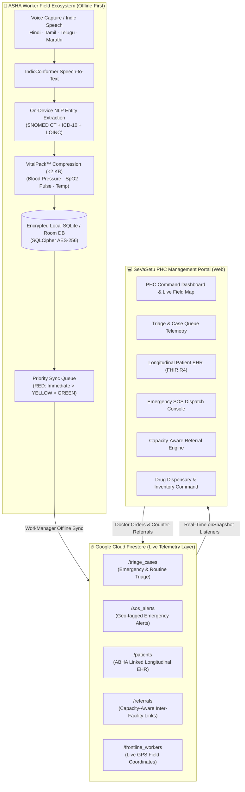

<div align="center">

  

  # SeVaSetu — सेवासेतु
  ### National Primary Health Centre (PHC) Tele-Triage & Coordination Portal

  **Smart India Hackathon (SIH) — Problem Statement ID: 26133**  
  *Bridging Grassroot ASHA Workers, Primary Health Centres & Tertiary Referral Networks*

  <p align="center">
    
    
    
    
  </p>

  <p align="center">
    <a href="#-project-overview">Overview</a> •
    <a href="#-system-architecture">Architecture</a> •
    <a href="#-key-features">Key Features</a> •
    <a href="#-technology-stack">Tech Stack</a> •
    <a href="#-quick-start">Quick Start</a> •
    <a href="#-multi-language-support">Multi-Language</a> •
    <a href="#-security--compliance">Security & Standards</a>
  </p>
</div>

---

## 🏛️ Project Overview

**SeVaSetu** is an enterprise-grade digital health command portal developed under the aegis of the **Ministry of Health and Family Welfare (MoHFW)** and the **National Health Mission (NHM)**. 

In rural and tribal India, Primary Health Centres (PHCs) and sub-centres face chronic constraints: fluctuating mobile connectivity, language barriers among grassroot Accredited Social Health Activists (**ASHA**), overcrowded outpatient departments, and lack of real-time specialist visibility at district tertiary hospitals. 

SeVaSetu eliminates these bottlenecks by coupling an **offline-first Android ASHA worker telemetry system** with a **centralized, capacity-aware web workstation** for Medical Officers and PHC Administrators.

---

## 🏗️ System Architecture



---

## 🚀 Key Features

### 1. 🇮🇳 Authentic Indian Government Aesthetic
- **National Emblem of India (Ashoka Stambh)** with *"सत्यमेव जयते"* (Satyameva Jayate) in vector format.
- **Official MoHFW Top Utility Bar**: Quick accessibility controls (`A-`, `A`, `A+`), system telemetry indicator, and live language switch.
- **National Tricolor Accent Ribbons**: Saffron (`#FF9933`), White (`#FFFFFF`), and Green (`#138808`) styling adhering to **GIGW 3.0** (Guidelines for Indian Government Websites).

### 2. 🌐 Full Multi-Language Support (`English` · `हिन्दी` · `தமிழ்`)
- One-click language switcher located in the global header bar.
- **Intelligent Non-Destructive DOM Translation Engine**: Translates all UI labels, navigation items, status pills, and medical terminology dynamically.
- Supported with **Google Noto Sans Devanagari** and **Noto Sans Tamil** typography.
- Preserves form inputs, search filters, and database keys without side effects.

### 3. 🚨 Real-Time Emergency SOS Incident Command
- Instant visual and auditory emergency broadcast whenever an ASHA worker triggers maternal, pediatric, or cardiac distress.
- Global Emergency Alert Banner spanning across all views with patient vitals and direct ambulance dispatch routing.
- Integrated with National Emergency Response System (`112`) and State Health Helpline (`104`).

### 4. 🩺 Offline-First Clinical Triage (VitalPack™ Protocol)
- Compressed `<2 KB` low-bandwidth payloads synchronized from field ASHA tablets.
- Categorized by the **Red-Yellow-Green Clinical Protocol**:
  - **RED (Critical)**: Immediate triage queue with ambulance pre-notification (e.g., Eclampsia, Acute Chest Pain).
  - **YELLOW (Urgent)**: Scheduled same-day teleconsultation (e.g., Uncontrolled Gestational Diabetes, Persistent High Fever).
  - **GREEN (Routine)**: Sub-centre follow-up and nutritional monitoring.

### 5. 🗂️ Longitudinal Patient EHR & ABHA Integration
- Ayushman Bharat Health Account (**ABHA**) 14-digit identifier federation.
- **FHIR R4 Standardized JSON Export**: Export patient longitudinal health records compatible with the National Digital Health Mission ecosystem.
- Complete clinical tracking: Encounters, Prescriptions, LOINC Pathology investigations, and ASHA field visit logs.

### 6. 🚑 Capacity-Aware Referral Network
- Live bed, ICU, oxygen, and specialist availability across District Hospitals and Medical Colleges.
- Pre-notifies trauma and emergency teams prior to patient arrival, preventing futile transfers and delays.
- Closed-loop counter-referrals: Discharged patients automatically update local ASHA follow-up schedules.

### 7. 🔐 Dual-Role Workstation Access & Security
- **PHC Administration (`ADMIN`)**: Staff accreditation, ASHA workforce management, pharmaceutical stock, and district reporting.
- **Medical Officer & Doctor (`DOCTOR`)**: Clinical triage stream, patient queue, e-prescriptions, and SOS handling.
- Government-grade security: Passcode toggle, **Visual Security Captcha Box**, and **`⚡ Quick Fill`** demo autofill chips for evaluation.

---

## 🛠️ Technology Stack

| Layer | Technologies |
| :--- | :--- |
| **Framework & Core** | React 19, TypeScript 5.7, Vite 8 |
| **Styling & Design System** | Tailwind CSS v4, Custom Theme Tokens (`@tailwindcss/vite`) |
| **UX Motion & Animation** | Motion (`motion/react`) |
| **Geospatial & Telemetry** | Leaflet 1.9, OpenStreetMap |
| **Cloud Database & Storage** | Google Cloud Firestore (NoSQL, Live Snapshots), Firebase Storage |
| **Icons & Assets** | Lucide React, Official SeVaSetu Vector Graphics |
| **Clinical Standards** | FHIR R4, SNOMED CT, LOINC, ICD-10 |
| **Compliance** | ABDM Milestones M1/M2/M3, GIGW 3.0, 256-Bit SSL/TLS Encryption |

---

## 📦 Quick Start

### Prerequisites
- **Node.js**: v18.0.0 or later (Node v20+ recommended)
- **npm**: v9.0.0 or later

### Installation

1. **Clone the repository**:
   ```bash
   git clone https://github.com/your-org/sevasetu.git
   cd sevasetu/sih-main
   ```

2. **Install dependencies**:
   ```bash
   npm install
   ```

3. **Configure Environment**:
   Copy `.env.example` to `.env` and fill in your Firebase credentials:
   ```env
   VITE_FIREBASE_API_KEY=YOUR_API_KEY_HERE
   VITE_FIREBASE_AUTH_DOMAIN=YOUR_PROJECT_ID.firebaseapp.com
   VITE_FIREBASE_PROJECT_ID=YOUR_PROJECT_ID
   VITE_FIREBASE_STORAGE_BUCKET=YOUR_PROJECT_ID.firebasestorage.app
   VITE_FIREBASE_MESSAGING_SENDER_ID=YOUR_MESSAGING_SENDER_ID
   VITE_FIREBASE_APP_ID=YOUR_APP_ID
   VITE_FIREBASE_MEASUREMENT_ID=YOUR_MEASUREMENT_ID
   ```
   > **Note:** Never commit your real `.env` file. It is excluded by `.gitignore`.

4. **Launch the Development Server**:
   ```bash
   npm run dev
   ```
   Open your browser and navigate to: **[http://localhost:8443/](http://localhost:8443/)**

5. **Type Checking & Lint**:
   ```bash
   npm run lint
   ```

---

## 🔑 Demo Access Credentials

Use the **`⚡ Quick Fill`** button on the sign-in screen, or enter the credentials below:

| Role | User ID / Email | Default Password | Access Level |
| :--- | :--- | :--- | :--- |
| **PHC Administrator** | `ADM-001` or `admin@demo.sevasetu.in` | `admin123` | Full PHC Administration, Workforce, Inventory |
| **Medical Officer / Doctor** | `DOC-PHC-0001` or `doctor@demo.sevasetu.in` | `doctor123` | Clinical Triage, Queue, Prescriptions, Referrals |

---

## 📂 Project Directory Structure

```
sih-main/
├── public/
│   └── sevasetu-logo.png             # Official SeVaSetu Logo (1024x296)
├── src/
│   ├── assets/
│   │   └── sevasetu-logo.png         # Source Logo Asset
│   ├── auth/
│   │   ├── AuthContext.tsx           # Session State & Role Management
│   │   └── authService.ts            # Authentication Providers & Demo Accounts
│   ├── components/
│   │   ├── GovEmblem.tsx             # National Emblem, Tricolor, GovTopBar & Footer
│   │   ├── Header.tsx                # Official Portal Header & Language Switcher
│   │   ├── Sidebar.tsx               # Primary Navigation & NHM Status
│   │   ├── GlobalSOSBanner.tsx       # Real-Time Emergency Audio-Visual Alert Bar
│   │   ├── LiveMap.tsx               # Geospatial ASHA Telemetry (Leaflet)
│   │   └── WelcomeScreen.tsx         # National Digital Health Portal Landing Page
│   ├── context/
│   │   ├── LanguageContext.tsx       # Multi-Language Provider & DOM Translator
│   │   └── translations.ts           # Comprehensive Healthcare Dictionary (EN/HI/TA)
│   ├── services/
│   │   └── firebase.ts               # Cloud Firestore Real-Time Sync & CRUD
│   ├── views/
│   │   ├── Dashboard.tsx             # PHC Incident Command & Summary Metrics
│   │   ├── Triage.tsx                # ASHA Telemetry Case Queue & Chat Stream
│   │   ├── Patients.tsx              # Longitudinal Patient EHR & FHIR R4 Records
│   │   ├── Referrals.tsx             # Capacity-Aware Inter-Facility Hospital Router
│   │   ├── Appointments.tsx          # Outpatient Department (OPD) Queue Management
│   │   ├── ASHAWorkers.tsx           # Grassroot Workforce Tracking & Sync Health
│   │   ├── Inventory.tsx             # Essential Drug Dispensary & Stock Alerts
│   │   ├── Followups.tsx             # High-Risk ANC & Chronic Care Protocol
│   │   ├── SOS.tsx                   # Dedicated Emergency SOS Command Center
│   │   ├── Reports.tsx               # HMIS Monthly & Epidemiological Analytics
│   │   ├── Settings.tsx              # Security, 2FA, and Station Configuration
│   │   ├── Login.tsx                 # Workstation Login with Role Switcher & Captcha
│   │   ├── RegisterAdmin.tsx         # PHC Administrator Registration
│   │   └── RegisterDoctor.tsx        # Medical Officer Registration
│   ├── App.tsx                       # Main Routing & Access Control
│   ├── firebaseConfig.ts             # Firebase Connection Secrets
│   ├── index.css                     # Tailwind CSS v4 & Noto Sans Indic Fonts
│   └── main.tsx                      # React DOM Entrypoint
├── package.json                      # Project Dependencies
├── tsconfig.json                     # TypeScript Configuration
└── vite.config.ts                    # Vite Build Configuration
```

---

## 🔒 Security & Privacy Compliance

- **Authentication**: Role-based access control (RBAC) separating administrative command from clinical operations.
- **Data Protection**: Designed in accordance with the **Digital Personal Data Protection (DPDP) Act 2023** and **IT Act 2000**.
- **Encryption**: End-to-end 256-Bit SSL/TLS transmission encryption for all patient and clinical data packets.
- **Audit Logging**: All triage decisions, referral dispatches, and medication prescriptions are timestamped and signed by the attending Medical Officer ID.

---

<div align="center">
  <sub>Developed for Smart India Hackathon (Problem ID: 26133). Built with ❤️ for India’s Public Healthcare Infrastructure.</sub>
</div>
