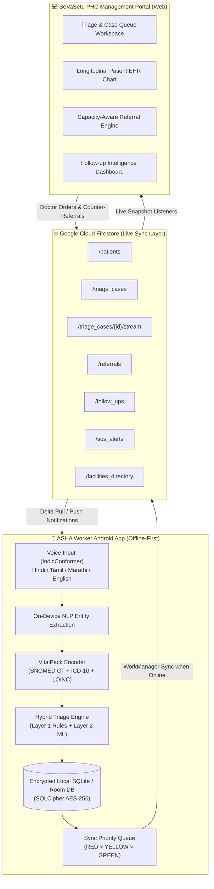

# 📱 SeVaSetu — ASHA Worker Android App ↔ Firestore Integration Guide

> **Official Integration Specification & Schema Blueprint**  
> **Source of Truth:** `SevaSetu_Prd.docx` (SIH Problem Statement ID: 26133)  
> **Target Environment:** Android Studio (Kotlin, Jetpack Compose, Room Database, Cloud Firestore, WorkManager)  
> **Web Portal:** SeVaSetu PHC Management Portal (React 19, TypeScript, Tailwind CSS v4)

---

## 📑 Table of Contents
1. [System Architecture & Data Flow Overview](#1-system-architecture--data-flow-overview)
2. [What Data to PUSH from ASHA Worker App → Firestore](#2-what-data-to-push-from-asha-worker-app--firestore)
3. [What Data to PULL from Firestore → ASHA Worker App](#3-what-data-to-pull-from-firestore--asha-worker-app)
4. [VitalPack™ Low-Bandwidth Clinical Payload Schema](#4-vitalpack-low-bandwidth-clinical-payload-schema)
5. [Firestore Collection Hierarchy & Document Schemas](#5-firestore-collection-hierarchy--document-schemas)
6. [Kotlin Data Models & Room Database Entities (Ready for Android Studio)](#6-kotlin-data-models--room-database-entities-ready-for-android-studio)
7. [Priority-Ordered Offline Sync Strategy (Red > Yellow > Green)](#7-priority-ordered-offline-sync-strategy-red--yellow--green)
8. [IndicConformer Multilingual Speech & NLP Extraction](#8-indicconformer-multilingual-speech--nlp-extraction)
9. [Firestore Security Rules & Indexes](#9-firestore-security-rules--indexes)

---

## 1. System Architecture & Data Flow Overview



---

## 2. What Data to PUSH from ASHA Worker App → Firestore

When the ASHA worker is in the field conducting village home visits, the Android app must collect and push the following 7 core data streams:

### 1. Patient Registration & Profile (`/patients/{patientId}`)
* **Demographics:** Full name, Age, Sex (`M` / `F`), Date of Birth, Phone number, Village name, Ward number, Block.
* **National Identity:** 14-digit ABHA ID (`14-XXXX-XXXX-XXXX`), ABHA verification KYC status, ABHA address string (`name@abdm`).
* **Frontline Worker Link:** Assigned `ashaId` (e.g. `ASHA-018`), `ashaName`, PHC Centre ID (`BR-PAT-PHC-042`).
* **Cohort Classification:** `ANC` (Maternal), `TB` (DOTS), `CHRONIC` (HTN/DM/CKD), `CHILD` (SAM Paediatric), `GENERAL`.
* **Clinical Badges & Risk:** Active medical conditions, baseline risk band (`RED` / `YELLOW` / `GREEN`).

### 2. Triage Encounter & Vitals (`/triage_cases/{caseId}`)
* **Multilingual Symptoms & Voice Transcript:** Raw text spoken by patient in Hindi / Tamil / Marathi, translated English transcript, recording metadata.
* **VitalPack Payload:** Structured, standardized clinical codes:
  * Symptoms encoded in **SNOMED CT** codes.
  * Provisional impression encoded in **ICD-10** codes.
  * Biomarkers/Lab tests encoded in **LOINC** codes.
* **Vitals Captured:** Heart Rate (bpm), SpO₂ (%), Blood Pressure (mmHg), Body Temp (°C), Respiratory Rate (/min), Weight (kg), Mid-Upper Arm Circumference (MUAC in cm for child health).
* **Capture Source:** `manual` (ASHA typed) or `wearable` (BLE synced).
* **On-Device Triage Result:**
  * `triageScore`: `RED` (Critical Emergency), `YELLOW` (Moderate / Urgent), `GREEN` (Routine / Normal).
  * `triageReason`: Plain-language clinical reasoning explanation generated on-device (e.g. *"SpO2 91% and high fever with tachypnea pattern"*).

### 3. Doctor-ASHA Unified Case Stream (`/triage_cases/{caseId}/stream/{msgId}`)
* **Clinical Handover Notes:** Field findings summary for the PHC Medical Officer.
* **Voice Dictation Notes:** Audio transcripts from `IndicConformer` mic module.
* **Two-Way Messages:** Urgent questions asked by the ASHA worker to the attending doctor.
* **Sender Info:** `senderType: "ASHA"`, `senderName`, `timestamp`, `snomedCodes: [...]`.

### 4. Emergency Referrals (`/referrals/{referralId}`)
* **Referral Indication:** Clinical emergency condition (e.g. Obstructed Labour, Anterior STEMI, Sputum AFB 2+).
* **Target Facility Match:** Destination hospital chosen from cached directory (e.g. AIIMS Patna, PMCH, Danapur SDH).
* **Transport Order:** 108 ALS Ambulance, 102 Janani Shishu Express, or ASHA accompanied.
* **GPS Coordinates:** Latitude & Longitude of patient for emergency ambulance dispatch.

### 5. Follow-up Visit Logs (`/follow_ups/{followUpId}`)
* **Maternal ANC Visits:** ANC Checkup #1, #2, #3, #4; IFA & Calcium tablet compliance; BP and weight monitoring.
* **TB DOTS Supervision:** Daily/weekly pill-count confirmation; adherence status (`Taken under observation`, `Missed dose`); sputum smear tracking.
* **Child Nutrition (NRC):** Weekly MUAC measurements, RUTF packet distribution, weight gain tracking.
* **Chronic NCDs:** Weekly blood pressure / blood sugar log; antihypertensive medication adherence.

### 6. Emergency Panic / SOS Alerts (`/sos_alerts/{alertId}`)
* **Immediate Escalation:** Triggered when rule-based red flag fires offline or ASHA hits the Panic button.
* **Payload:** Patient ID, Emergency Type (`MATERNAL_COLLAPSE`, `CARDIAC_CHEST_PAIN`, `SEVERE_RESPIRATORY_DISTRESS`, `TRAUMA`), exact GPS pin, contact phone.

### 7. Frontline Status & Heartbeat (`/frontline_workers/{ashaId}`)
* **Telemetry:** Battery level, network state (`2G`, `4G`, `OFFLINE`), pending sync queue size, last sync timestamp, current active ward.

---

## 3. What Data to PULL from Firestore → ASHA Worker App

The Android app sets up real-time Firestore listeners or delta-pull WorkManager jobs to sync data back from the PHC portal:

### 1. Doctor Consultation Orders & Treatment Plans
* Real-time responses from the PHC Medical Officer on `/triage_cases/{caseId}/stream`.
* Confirmed clinical diagnoses and prescription orders (`drug`, `dosage`, `frequency`, `duration`).

### 2. Referral Tracking & Counter-Referrals (PRD §7.3)
* Updated referral stage: `dispatched` → `in_transit` → `reached` → `seen` → `outcome`.
* **Counter-Referral Summary:** Hospital discharge notes, revised prescriptions, and post-discharge home care instructions for the ASHA worker.

### 3. Scheduled Follow-up Cadence (Follow-up Intelligence Engine)
* Daily follow-up task list generated by the PHC system for maternal ANC, child immunization, and chronic disease cadences.
* Alerts for patients who missed appointments or have abnormal wearable biomarker trends.

### 4. Cached Facilities & Inventory Directory (`/facilities_directory`)
* Offline directory of hospitals, specialized departments, emergency bed capacity, and essential medicine stock status for the ASHA app's offline referral routing engine.

---

## 4. VitalPack™ Low-Bandwidth Clinical Payload Schema

> Per **PRD Section 7.2**, `VitalPack` converts complex health assessments into a compact, standardized binary/JSON structure using global standards before transmission.

```json
{
  "vitalPackVersion": "2.0",
  "encodingFormat": "VITALPACK_JSON",
  "patientAbhaId": "14-3301-8847-0023",
  "timestamp": 1725184980000,
  "vitals": {
    "bpSystolic": 158,
    "bpDiastolic": 102,
    "heartRateBpm": 108,
    "spo2Percent": 92,
    "tempCelsius": 37.2,
    "respRatePerMin": 22,
    "source": "wearable_ble"
  },
  "symptomsSnomed": [
    { "code": "29857009", "term": "Chest pain radiating to left arm", "severity": "severe" },
    { "code": "267036007", "term": "Shortness of breath", "severity": "moderate" },
    { "code": "415690000", "term": "Diaphoresis / Profuse sweating", "severity": "severe" }
  ],
  "provisionalIcd10": [
    { "code": "I21.0", "description": "Acute transmural myocardial infarction of anterior wall" }
  ],
  "loincObservations": [
    { "code": "11524-6", "name": "12-Lead ECG", "value": "ST elevation V1-V4", "status": "ABNORMAL" }
  ],
  "triageDecision": {
    "riskBand": "RED",
    "engineVersion": "HYBRID_RULE_ML_V2.1",
    "confidence": 0.96,
    "reasoning": "Red rule triggered: SpO2 92% with cardiac chest pain and ST elevation pattern."
  }
}
```

---

## 5. Firestore Collection Hierarchy & Document Schemas

```
firestore_root/
├── patients/                      (Collection)
│   └── {patientId}/               (Document: Demographics, ABHA, Cohort)
│
├── triage_cases/                  (Collection: Field Triage & OPD Encounters)
│   └── {caseId}/                  (Document: Triage Score, Vitals, VitalPack)
│       └── stream/                (Subcollection: Unified Doctor-ASHA Case Stream)
│           └── {messageId}/       (Document: Text, Audio, NLP entities)
│
├── referrals/                     (Collection: 5-Stage Inter-Facility Referrals)
│   └── {referralId}/              (Document: Facilities, Transport, Counter-Referral)
│
├── follow_ups/                    (Collection: Cadence Task Engine)
│   └── {followUpId}/              (Document: DOTS/ANC/Child Adherence Logs)
│
├── sos_alerts/                    (Collection: Emergency Panic Escalation)
│   └── {alertId}/                 (Document: GPS Pin, Emergency Code, Status)
│
├── facilities_directory/          (Collection: Receiving Hospitals & Stock)
│   └── {facilityId}/              (Document: Beds, Specialties, Stock Status)
│
└── frontline_workers/             (Collection: ASHA Profile & Heartbeat)
    └── {ashaId}/                  (Document: Device Telemetry, Assigned Ward)
```

---

## 6. Kotlin Data Models & Room Database Entities (Ready for Android Studio)

Copy the following data classes directly into your Android Studio project under `com.sevasetu.asha.data.local`:

### 1. `PatientEntity.kt` (Room Entity + Firestore Map)
```kotlin
package com.sevasetu.asha.data.local

import androidx.room.Entity
import androidx.room.PrimaryKey
import com.google.firebase.firestore.PropertyName
import java.util.UUID

@Entity(tableName = "patients")
data class PatientEntity(
    @PrimaryKey
    val id: String = "BR-PAT-" + UUID.randomUUID().toString().take(8).uppercase(),
    
    @get:PropertyName("abhaId")
    val abhaId: String = "",
    
    @get:PropertyName("name")
    val name: String = "",
    
    @get:PropertyName("age")
    val age: Int = 0,
    
    @get:PropertyName("sex")
    val sex: String = "F", // "M" or "F"
    
    @get:PropertyName("village")
    val village: String = "",
    
    @get:PropertyName("ward")
    val ward: String = "",
    
    @get:PropertyName("block")
    val block: String = "Danapur",
    
    @get:PropertyName("mobile")
    val mobile: String = "",
    
    @get:PropertyName("ashaId")
    val ashaId: String = "",
    
    @get:PropertyName("ashaName")
    val ashaName: String = "",
    
    @get:PropertyName("cohort")
    val cohort: String = "GENERAL", // "ANC", "TB", "CHRONIC", "CHILD", "GENERAL"
    
    @get:PropertyName("conditions")
    val conditions: List<String> = emptyList(),
    
    @get:PropertyName("riskBand")
    val riskBand: String = "GREEN", // "RED", "YELLOW", "GREEN"
    
    @get:PropertyName("syncStatus")
    var syncStatus: String = "PENDING", // "PENDING", "SYNCED", "FAILED"
    
    @get:PropertyName("updatedAt")
    val updatedAt: Long = System.currentTimeMillis()
)
```

---

### 2. `TriageCaseEntity.kt` (Encounter & VitalPack Data)
```kotlin
package com.sevasetu.asha.data.local

import androidx.room.Entity
import androidx.room.PrimaryKey
import com.google.firebase.firestore.PropertyName
import java.util.UUID

@Entity(tableName = "triage_cases")
data class TriageCaseEntity(
    @PrimaryKey
    val id: String = "CASE-" + UUID.randomUUID().toString().take(8).uppercase(),
    
    @get:PropertyName("patientId")
    val patientId: String = "",
    
    @get:PropertyName("patientName")
    val patientName: String = "",
    
    @get:PropertyName("ashaId")
    val ashaId: String = "",
    
    @get:PropertyName("symptomsTranscript")
    val symptomsTranscript: String = "", // Voice transcript in Hindi/Tamil/Marathi
    
    @get:PropertyName("symptomsLanguage")
    val symptomsLanguage: String = "hi-IN",
    
    @get:PropertyName("riskBand")
    val riskBand: String = "GREEN", // "RED", "YELLOW", "GREEN"
    
    @get:PropertyName("riskReason")
    val riskReason: String = "",
    
    // Biomarkers
    @get:PropertyName("systolicBP")
    val systolicBP: Int? = null,
    
    @get:PropertyName("diastolicBP")
    val diastolicBP: Int? = null,
    
    @get:PropertyName("heartRate")
    val heartRate: Int? = null,
    
    @get:PropertyName("spo2")
    val spo2: Int? = null,
    
    @get:PropertyName("tempCelsius")
    val tempCelsius: Double? = null,
    
    @get:PropertyName("respRate")
    val respRate: Int? = null,
    
    @get:PropertyName("muacCm")
    val muacCm: Double? = null, // Paediatric MUAC
    
    @get:PropertyName("vitalsSource")
    val vitalsSource: String = "manual", // "manual" or "wearable"
    
    // VitalPack clinical codes
    @get:PropertyName("snomedCodes")
    val snomedCodes: List<String> = emptyList(),
    
    @get:PropertyName("icdCodes")
    val icdCodes: List<String> = emptyList(),
    
    @get:PropertyName("status")
    val status: String = "SUBMITTED", // "SUBMITTED", "REVIEWED", "RESOLVED"
    
    @get:PropertyName("syncStatus")
    var syncStatus: String = "PENDING",
    
    @get:PropertyName("createdAt")
    val createdAt: Long = System.currentTimeMillis()
)
```

---

### 3. `CaseStreamMessage.kt` (Doctor-ASHA Chat & Voice Notes)
```kotlin
package com.sevasetu.asha.data.local

import com.google.firebase.firestore.PropertyName
import java.util.UUID

data class CaseStreamMessage(
    @get:PropertyName("id")
    val id: String = "MSG-" + UUID.randomUUID().toString().take(8),
    
    @get:PropertyName("caseId")
    val caseId: String = "",
    
    @get:PropertyName("senderType")
    val senderType: String = "ASHA", // "ASHA" or "DOCTOR"
    
    @get:PropertyName("senderName")
    val senderName: String = "",
    
    @get:PropertyName("type")
    val type: String = "chat", // "chat", "voice_dictation", "clinical_note"
    
    @get:PropertyName("content")
    val content: String = "",
    
    @get:PropertyName("snomedTags")
    val snomedTags: List<String> = emptyList(),
    
    @get:PropertyName("timestamp")
    val timestamp: Long = System.currentTimeMillis()
)
```

---

### 4. `ReferralEntity.kt` (5-Stage Referral Record)
```kotlin
package com.sevasetu.asha.data.local

import androidx.room.Entity
import androidx.room.PrimaryKey
import com.google.firebase.firestore.PropertyName
import java.util.UUID

@Entity(tableName = "referrals")
data class ReferralEntity(
    @PrimaryKey
    val id: String = "REF-2024-" + UUID.randomUUID().toString().take(6).uppercase(),
    
    @get:PropertyName("patientId")
    val patientId: String = "",
    
    @get:PropertyName("patientName")
    val patientName: String = "",
    
    @get:PropertyName("abhaId")
    val abhaId: String = "",
    
    @get:PropertyName("ashaId")
    val ashaId: String = "",
    
    @get:PropertyName("diagnosis")
    val diagnosis: String = "",
    
    @get:PropertyName("facilityName")
    val facilityName: String = "PMCH Patna",
    
    @get:PropertyName("specialty")
    val specialty: String = "Emergency Medicine",
    
    @get:PropertyName("priority")
    val priority: String = "emergency", // "emergency", "urgent", "routine"
    
    @get:PropertyName("stage")
    var stage: String = "dispatched", // "dispatched", "in_transit", "reached", "seen", "outcome"
    
    @get:PropertyName("transportMode")
    val transportMode: String = "108 ALS Ambulance",
    
    @get:PropertyName("latitude")
    val latitude: Double? = null,
    
    @get:PropertyName("longitude")
    val longitude: Double? = null,
    
    @get:PropertyName("counterReferralNotes")
    var counterReferralNotes: String? = null,
    
    @get:PropertyName("syncStatus")
    var syncStatus: String = "PENDING",
    
    @get:PropertyName("createdAt")
    val createdAt: Long = System.currentTimeMillis()
)
```

---

## 7. Priority-Ordered Offline Sync Strategy (Red > Yellow > Green)

Per **PRD Section 7.5**, when an ASHA worker's Android device regains cellular or Wi-Fi signal, the **Android WorkManager** queue MUST synchronize data in strict priority order:

1. **🔴 Priority 1 (RED Emergency & SOS):**
   - Dispatches emergency referrals, SOS triggers with GPS pins, and critical vital alarms.
   - Syncs within **< 30 seconds** of signal detection.
2. **🟡 Priority 2 (YELLOW Moderate & New Patients):**
   - Syncs ANC maternity checkups, TB DOTS encounters, and new ABHA registrations.
3. **🟢 Priority 3 (GREEN Routine & Heartbeats):**
   - Syncs routine follow-up logs, device battery status, and standard field observations.

### WorkManager Sync Worker Example (Kotlin):
```kotlin
package com.sevasetu.asha.sync

import android.content.Context
import androidx.work.CoroutineWorker
import androidx.work.WorkerParameters
import com.google.firebase.firestore.FirebaseFirestore
import com.sevasetu.asha.data.local.AppDatabase
import kotlinx.coroutines.tasks.await

class FirestoreSyncWorker(
    appContext: Context,
    workerParams: WorkerParameters
) : CoroutineWorker(appContext, workerParams) {

    private val firestore = FirebaseFirestore.getInstance()
    private val db = AppDatabase.getInstance(appContext)

    override suspend fun doWork(): Result {
        return try {
            // 1. Sync Priority RED Cases First
            syncCasesByPriority("RED")
            
            // 2. Sync Priority YELLOW Cases
            syncCasesByPriority("YELLOW")
            
            // 3. Sync Priority GREEN Cases
            syncCasesByPriority("GREEN")
            
            // 4. Sync Patients & Referrals
            syncPendingPatients()
            syncPendingReferrals()
            
            Result.success()
        } catch (e: Exception) {
            Result.retry()
        }
    }

    private suspend fun syncCasesByPriority(riskBand: String) {
        val pendingCases = db.triageDao().getPendingByRisk(riskBand)
        for (caseEntity in pendingCases) {
            firestore.collection("triage_cases")
                .document(caseEntity.id)
                .set(caseEntity)
                .await()
            
            // Mark synced in local Room SQLite
            db.triageDao().markSynced(caseEntity.id)
        }
    }

    private suspend fun syncPendingPatients() {
        val pendingPatients = db.patientDao().getPending()
        for (patient in pendingPatients) {
            firestore.collection("patients")
                .document(patient.id)
                .set(patient)
                .await()
            db.patientDao().markSynced(patient.id)
        }
    }

    private suspend fun syncPendingReferrals() {
        val pendingReferrals = db.referralDao().getPending()
        for (ref in pendingReferrals) {
            firestore.collection("referrals")
                .document(ref.id)
                .set(ref)
                .await()
            db.referralDao().markSynced(ref.id)
        }
    }
}
```

---

## 8. IndicConformer Multilingual Speech & NLP Extraction

The ASHA worker speaks in their regional native dialect. In the Android app:
1. **Speech-to-Text Engine:** `IndicConformer` quantized on-device model (`hi-IN` Hindi, `ta-IN` Tamil, `mr-IN` Marathi, `en-IN` English).
2. **Clinical NLP Keyword Extraction:**
   * e.g., *"तीन हफ्ते से खांसी और बुखार"* (Cough for 3 weeks & fever)
   * On-device NLP maps keywords to:
     * `snomedCodes: ["49727002" (Cough), "386661006" (Fever)]`
     * `provisionalIcd10: ["A16.2" (Pulmonary TB)]`
     * `suggestedCohort: "TB"`
     * `triageScore: "YELLOW"`

---

## 9. Firestore Security Rules & Indexes

Add these rules to your Firebase Console under `firestore.rules`:

```javascript
rules_version = '2';
service cloud.firestore {
  match /databases/{database}/documents {
    
    // Helper: Check authentication
    function isAuthenticated() {
      return request.auth != null;
    }

    // Patients collection
    match /patients/{patientId} {
      allow read, write: if isAuthenticated();
    }

    // Triage encounters and case stream
    match /triage_cases/{caseId} {
      allow read, write: if isAuthenticated();
      
      match /stream/{msgId} {
        allow read, write: if isAuthenticated();
      }
    }

    // Referrals
    match /referrals/{referralId} {
      allow read, write: if isAuthenticated();
    }

    // Follow-ups
    match /follow_ups/{followUpId} {
      allow read, write: if isAuthenticated();
    }

    // Emergency SOS alerts
    match /sos_alerts/{alertId} {
      allow read, write: if isAuthenticated();
    }

    // Directory (Read-only for ASHA app)
    match /facilities_directory/{facilityId} {
      allow read: if isAuthenticated();
      allow write: if false; // Managed by District Admin
    }

    // Frontline worker profiles
    match /frontline_workers/{ashaId} {
      allow read, write: if isAuthenticated();
    }
  }
}
```

### Composite Indexes Needed:
1. `triage_cases`: `riskBand` (ASC) + `createdAt` (DESC)
2. `referrals`: `priority` (ASC) + `stage` (ASC) + `createdAt` (DESC)
3. `follow_ups`: `ashaId` (ASC) + `dueDate` (ASC) + `status` (ASC)

---

## 🚀 Summary Checklist for Android Studio Developer

- [x] Create **Room Entities** (`PatientEntity`, `TriageCaseEntity`, `ReferralEntity`) with `syncStatus` flags.
- [x] Implement **WorkManager** `FirestoreSyncWorker` with network constraint and priority ordering (`RED` first).
- [x] Configure Firebase SDK in `build.gradle.kts` (`com.google.firebase:firebase-firestore-ktx`).
- [x] Integrate on-device `IndicConformer` speech recognition for regional language dictation.
- [x] Ensure `VitalPack` JSON payload matches the web portal's SNOMED/ICD decoder.
- [x] Setup Firestore snapshot listeners on `/triage_cases/{caseId}/stream` for real-time doctor responses.
